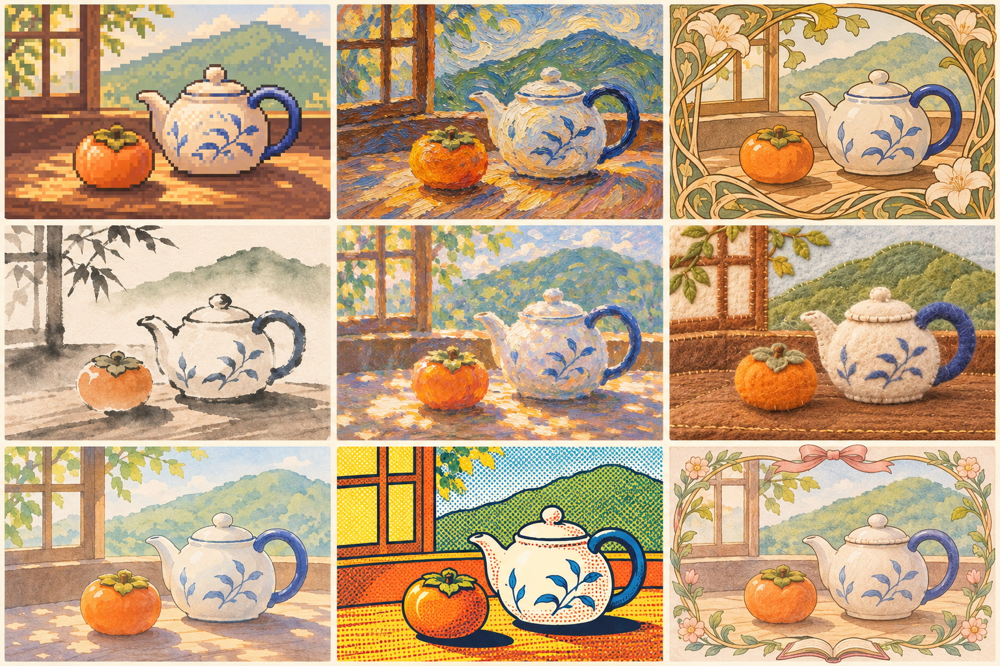

# Shaw Style｜九风格照片转译

把人物、风景或产品照片转成明确的艺术风格，同时尽量保留主体的身份、姿态、空间关系和结构。

**v0.1.0 测试版 · 九种风格 · 人物／风景／产品**



> **概念示意：**上图用同一组茶壶与柿子展示九种画面语言，是为 README 制作的插画；它不是 `shaw-style` 封装后的实测输出，也不代表不同生图工具都能得到同样效果。

## 它能做什么

| 你提供 | 你选择 | Skill 帮你做 |
| --- | --- | --- |
| 原照片，或文字创意 | 九种风格中的一种 | 组织风格规则、保留主体特征，并检查生成结果 |

`shaw-style` 是 Agent Skill，提供文字规则；**它本身不包含生图模型、运行服务或 API 密钥**。直接出图需要当前 Agent 具备相应的看图和生图能力。

## 九种风格

上面的图按从左到右、从上到下排列：

| 编号 | 风格 | 主要画面特征 |
| --- | --- | --- |
| 01 | 暖萌像素 | 有体积和生活气息的像素画 |
| 02 | 梵高式动漫油画 | 旋动笔触、浓厚色彩 |
| 03 | 慕夏式装饰肖像 | 装饰线条、花饰与柔和色阶 |
| 04 | 水墨淡彩 | 留白、墨色与克制点染 |
| 05 | 莫奈式光色动漫 | 斑驳光色与轻盈空气感 |
| 06 | 毛毡玩偶 | 纤维触感与手工造型 |
| 07 | 吉卜力水彩 | 透明水色与温柔背景 |
| 08 | 波普艺术 | 高对比色块与网点语言 |
| 09 | 布达佩斯粉彩对称 | 柔和粉彩与秩序感构图 |

每种风格单独生成一张。比较图可以另外整理，不用拼图替代需要交付的单张成品。

## 怎么开始

下载完整的 `shaw-style` 文件夹，放入当前 Agent 支持的个人或工作区 Skills 目录。Codex 常用位置为 `~/.codex/skills/`；本机也可放在 `~/.agents/skills/`。安装后保留 `SKILL.md`、`agents/` 和 `references/`，再刷新技能或新建会话。

上传原照片后，可以这样说：

```text
使用 $shaw-style，把这张山湖照片转成莫奈风格。
保留山脊、岸线和树林分布，不要新增建筑。
```

也可以一次要求两种风格，Skill 会分别生成。若当前环境不能生图，它会交付完整提示词，并说明图片尚未生成。其他支持 `SKILL.md` 的 Agent 可按各自的安装方式导入。

## 画风变化时保留什么

| 题材 | 重点保留 |
| --- | --- |
| 人物 | 身份、脸型、表情和原始姿态 |
| 风景 | 山脊、岸线、树林等景物的空间关系 |
| 产品 | 轮廓、比例与关键部件 |

主体与背景使用统一的绘画语言，而不是只给照片盖上一层风格纹理。完整的执行规则见 [SKILL.md](SKILL.md)，九种风格的选择见 [风格目录](references/style-catalog.md)。

## 状态与许可

本版尚未完成跨不同生图智能体的统一效果验证。私人原照和生成图不会自动加入公开样例。技能文字与仓库代码采用 [MIT License](LICENSE)；输入照片及生成图片的权利需分别确认。风格名称仅用于描述审美方向，不表示官方合作。
